<!--
  README de perfil de GitHub.
  Instrucciones: crea un repositorio PUBLICO con el nombre exacto de tu usuario de GitHub
  (por ejemplo, <tu-usuario>/<tu-usuario>) y sube este README.md junto con la carpeta assets/.
  Reemplaza <tu-usuario>, <tu-perfil> y <tu-correo> antes de publicar.
-->

<a href="https://github.com/<tu-usuario>/cyberphysical-agents#proyecto-destacado-plague-bot-vr"></a>

<!-- Cuando el repositorio del perro robótico exista, envuelve la imagen en un enlace: <a href="https://github.com/<tu-usuario>/<repo>">...</a> -->

<a href="https://github.com/<tu-usuario>/cyberphysical-agents"></a>

**Lo que me enseñó la robótica y hoy aplico a los agentes de IA**

- **La entrada sucia es la norma.** Un invernadero con oclusión lumínica y un cliente que escribe cuatro problemas en una frase se resuelven igual: normalizar primero, decidir después.
- **No gastar el cómputo más caro por defecto.** Modelos ligeros para clasificar y rutear, modelos robustos solo para razonamiento complejo.
- **Lo crítico se resuelve con lógica determinista.** Máquinas de estados (LangGraph) para flujos que no pueden fallar; equipos de agentes (CrewAI) donde la variación es aceptable.
- **Herramientas con permisos, no con improvisación.** MCP para integrar bases de datos y sistemas externos sin que el modelo invente datos.

<a href="https://www.linkedin.com/in/<tu-perfil>"></a>
&nbsp;
<a href="mailto:<tu-correo>"></a>
&nbsp;
<a href="https://github.com/<tu-usuario>"></a>

